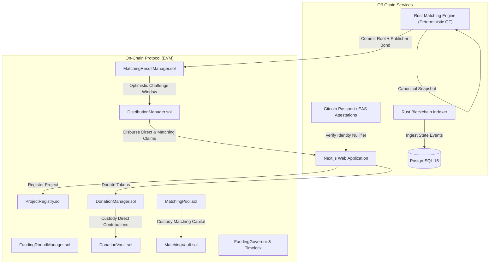

# Quadratic Funding Platform

An enterprise-grade, round-based, Sybil-resistant Quadratic Funding protocol built for EVM-compatible blockchains. The platform implements capital-constrained Quadratic Voting / Quadratic Funding (CLR) with off-chain deterministic calculation, optimistic Merkle tree dispute windows, and decentralized community governance.

---

## Architecture Overview



---

## Monorepo Directory Layout

```
.
├── contracts/                  # Solidity smart contracts & Foundry suite
│   ├── src/
│   │   ├── core/               # ProjectRegistry, FundingRoundManager, Vaults, MatchingResultManager, etc.
│   │   ├── interfaces/         # Standard contract interfaces
│   │   └── libraries/          # FixedPointMath, MerkleProofLib, ProtocolConstants, Errors
│   ├── test/                   # Unit, property, and invariant test suite
│   ├── script/                 # Testnet deployment scripts
│   └── foundry.toml            # Solidity compiler & optimizer configuration
├── backend/                    # Rust backend workspace
│   ├── services/
│   │   ├── matching-engine/    # Deterministic QF calculation & Merkle tree generation
│   │   ├── api/                # Axum REST API service
│   │   └── indexer/            # Reorganization-safe blockchain event indexer
│   └── migrations/             # PostgreSQL database schema & indices
├── frontend/                   # Next.js 15 App Router web application
│   ├── src/app/                # Landing, Project Discovery, Rounds, Donation, and Dashboard
│   └── src/lib/                # Wagmi / Viem contract clients and ABIs
├── packages/sdk/               # @quadratic-funding/sdk TypeScript client
├── docs/                       # Architectural specifications, threat model, math, and invariants
│   ├── architecture/
│   │   ├── system-overview.md
│   │   ├── threat-model.md
│   │   ├── invariants.md
│   │   └── quadratic-funding-math.md
├── ROADMAP.md                  # Comprehensive 29-phase development tracker
└── .github/workflows/ci.yml    # Continuous integration pipeline
```

---

## Critical Protocol Invariants

1. **Matching Fund Conservation**: $\sum \text{Allocated Matching} \le \text{MatchingVault.balance}$
2. **Direct Donation Conservation**: $\sum \text{Disbursed Donations} \le \text{DonationVault.balanceForRound}$
3. **Sybil Nullifier Aggregation**: For any project $P$ and round $R$, each unique verified human identity nullifier $\mathcal{N}$ contributes at most once towards the quadratic matching calculation:
   $$\text{RawScore}(P) = \left( \sum_{\mathcal{N} \in \mathcal{I}} \sqrt{\sum c_{\mathcal{N}, P}} \right)^2$$
4. **Deterministic Calculation Reproducibility**: Identical contribution snapshots produce bit-for-bit identical Merkle roots across Rust, TypeScript, and EVM reference implementations.
5. **No Double Payout Claims**: Each project payout can be claimed at most once per round through `DistributionManager.sol`.
6. **Optimistic Challenge Window**: Matching funds cannot be claimed before the challenge timelock has elapsed without active dispute.

---

## Getting Started

### 1. Prerequisites
- **Node.js**: v20+ or v24+
- **Rust**: v1.80+ (`cargo`)
- **Foundry**: `forge`, `cast`
- **PostgreSQL**: 16+

### 2. Smart Contracts (Foundry)
```bash
cd contracts
forge test
forge script script/DeployProtocol.s.sol --rpc-url $SEPOLIA_RPC_URL --broadcast
```

### 3. Rust Backend & Matching Engine
```bash
cd backend
# Run unit tests
cargo test -p matching-engine

# Start REST API service
cargo run -p api

# Start Event Indexer
cargo run -p indexer
```

### 4. Next.js Frontend
```bash
cd frontend
npm install
npm run dev
# Open http://localhost:3000
```

### 5. TypeScript SDK
```bash
cd packages/sdk
npm install
npm run build
npm test
```

---

## Quadratic Funding Formula Reference

$$\text{Matching Demand}(P) = \left( \sum_{i \in \mathcal{I}_P} \sqrt{c_{i, P}} \right)^2 - \sum_{i \in \mathcal{I}_P} c_{i, P}$$

$$\text{Normalized Allocation}(P) = M_{\text{total}} \times \frac{\text{Matching Demand}(P)}{\sum_{Q \in \mathcal{P}} \text{Matching Demand}(Q)}$$

All arithmetic is evaluated in **18-decimal fixed-point integers (WAD)** with Newton-Raphson Babylonian square root and deterministic remainder dust allocation.

---

## License
MIT
