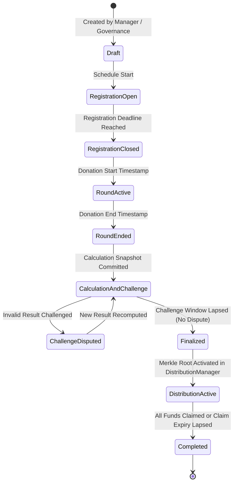

# GrantFlow Protocol — System Architecture & Specification

## 1. Executive Summary & Platform Objectives

The **GrantFlow** protocol is an enterprise-grade, round-based public goods funding protocol engineered for Ethereum Virtual Machine (EVM) compatible networks. It implements Capital-constrained Quadratic Voting / Quadratic Funding (CLR) as formulated by Buterin, Hitzig, and Weyl (2018), prioritizing the number of unique contributors over the raw financial magnitude of contributions.

### Core Objectives
1. **Democratic Capital Allocation**: Maximize matching funds for public goods that receive broad grassroots consensus.
2. **Sybil Resistance & Identity Integrity**: Prevent Sybil farming through modular attestation adapters (Gitcoin Passport, EAS, Soulbound credentials) and cryptographic nullifiers.
3. **Provable Financial Conservation**: Vault-separated direct donations and matching funds with deterministic off-chain calculation validated via Merkle roots and optimistic challenge windows.
4. **Decentralized Governance**: Community-led round parameters, project whitelisting, dispute arbitration, and emergency controls administered through an OpenZeppelin Governor and Timelock.

---

## 2. Participant Roles & Permissions

| Role | Responsibilities | Permissions & Controls |
| :--- | :--- | :--- |
| **Donor (Contributor)** | Contributes ERC-20 tokens to verified projects in active funding rounds. | May contribute up to `maxDonation` per transaction/round; must present valid identity proof/nullifier for matching eligibility. |
| **Project Owner** | Registers projects with decentralized metadata (IPFS), applies to funding rounds, claims payouts. | Can update project metadata before final freeze; transfers ownership; executes Merkle claims for matching funds. |
| **Matching Sponsor** | Contributes capital to the matching pool for specific rounds or general public goods pools. | Deposits approved ERC-20 tokens; receives on-chain sponsor receipt; eligible for refunds only if round is aborted before commencement. |
| **Round Manager** | Configures round schedules, minimum/maximum thresholds, eligible categories, and whitelisting. | Controlled by protocol governance or designated multisig; cannot unilaterally redirect vault funds. |
| **Governance Participant** | Holds governance tokens / voting weight; votes on proposals, dispute arbitrations, parameter adjustments. | Proposes and votes on `FundingGovernor`; queued through `GovernanceTimelock`. |
| **Protocol Administrator** | Multisig / Timelock holding emergency pause and role assignment capabilities. | Can trigger granular circuit-breakers (`Pausable`); governed by strict timelocks. |

---

## 3. System Architecture & Off-Chain / On-Chain Trust Boundaries

```mermaid
flowchart TD
    subgraph "Off-Chain Layer"
        User["User / Contributor"]
        ProjOwner["Project Owner"]
        Passport["Identity Provider (Gitcoin / EAS)"]
        FE["Next.js Web Frontend (Wagmi / Viem)"]
        Indexer["Rust Blockchain Indexer"]
        CalcEngine["Rust Matching Engine"]
        IPFS[("IPFS (Project Metadata & CIDs)")]
        DB[("PostgreSQL Database")]
    end

    subgraph "On-Chain Protocol (EVM)"
        Registry["ProjectRegistry.sol"]
        RoundMgr["FundingRoundManager.sol"]
        DonationVault["DonationVault.sol"]
        DonationMgr["DonationManager.sol"]
        MatchingVault["MatchingVault.sol"]
        MatchingPool["MatchingPool.sol"]
        ResultMgr["MatchingResultManager.sol"]
        DistMgr["DistributionManager.sol"]
        Governor["FundingGovernor & Timelock"]
    end

    User -->|Connects & Donates| FE
    ProjOwner -->|Uploads Spec| IPFS
    ProjOwner -->|Registers Project| Registry
    FE -->|Queries APIs| Indexer
    Passport -.->|Cryptographic Credential| FE

    FE -->|donate() with Identity Proof| DonationMgr
    DonationMgr -->|Stores Funds| DonationVault
    MatchingPool -->|Locks Matching Capital| MatchingVault

    Indexer -->|Ingests Events| DB
    CalcEngine -->|Reads Canonical Snapshot| DB
    CalcEngine -->|Generates Allocation Merkle Tree| CalcEngine
    CalcEngine -->|Submits Root + Publisher Bond| ResultMgr

    ResultMgr -->|After Challenge Period Finalization| DistMgr
    DistMgr -->|Withdraws Direct Donations| DonationVault
    DistMgr -->|Withdraws Matching Share| MatchingVault
    ProjOwner -->|claim(MerkleProof)| DistMgr
```

### Trust Boundaries
1. **On-Chain Vaults are Trustless**: `DonationVault` and `MatchingVault` hold protocol custody. Funds can **only** be released through authenticated calls from `DistributionManager` under valid, finalized Merkle roots or refund conditions.
2. **Optimistic Off-Chain Calculation**: Calculating $O(N \cdot M)$ square roots and high-precision normalizations on-chain is prohibitive for gas. The protocol employs an **Optimistic Matching Pipeline**:
   - The Rust engine computes allocations from on-chain event snapshots.
   - The engine commits `merkleRoot`, `inputSnapshotHash`, and publisher bond on-chain.
   - A **Challenge Window** (e.g., 7 days) allows any participant to dispute calculations by presenting counter-proofs.
   - Upon window expiry without valid disputes, the root transitions to `Finalized`.

---

## 4. Funding Round Lifecycle



---

## 5. Project Registration & Eligibility Standards

1. **Decentralized Metadata**: Project title, logo, description, milestones, category, and website must be bundled into an RFC-compliant JSON schema and pinned to IPFS. The IPFS Content Identifier (CIDv1) is registered on-chain in `ProjectRegistry.sol`.
2. **Payout Recipient**: Each project designates an immutable or governance-updatable `payoutAddress`.
3. **Eligibility Verification**:
   - Project must be approved by Round Reviewers (`ProjectReviewManager`).
   - Projects cannot register duplicates with identical payout addresses or duplicate CIDs.
   - Projects suspended by governance or flagged in dispute proceedings are prevented from round enrollment.

---

## 6. Financial Architecture & Supported Payment Tokens

- **Supported Currencies**: Whitelisted standard ERC-20 tokens (e.g., USDC, USDT, DAI, WETH).
- **Decimal Normalization**: All mathematical calculations internally normalize token values to **18 decimal places ($10^{18}$ fixed point)** to prevent rounding distortions across 6-decimal (USDC) and 18-decimal (DAI) tokens.
- **Platform Fee Structure**:
   - Configurable protocol fee (default: $0\%$, cap: $\le 2.5\%$) directed to community treasury for protocol sustainability, strictly managed by `FundingGovernor`.

---

## 7. Dispute Resolution & Emergency Governance

1. **Dispute Manager**: Allows verified community reviewers or stakeholders to stake bonds and submit challenges against suspect projects (e.g., fraudulent deliverables, impersonation).
2. **Disqualification Impact**: If a project is disqualified before round finalization, its direct donations become refundable to donors, and its matching allocation is redistributed to the remaining pool.
3. **Emergency Circuit Breaker**: Individual modules inherit OpenZeppelin `Pausable`. The multisig emergency admin can pause new deposits or claims during anomalous events while remaining unable to extract funds without timelock approval.
